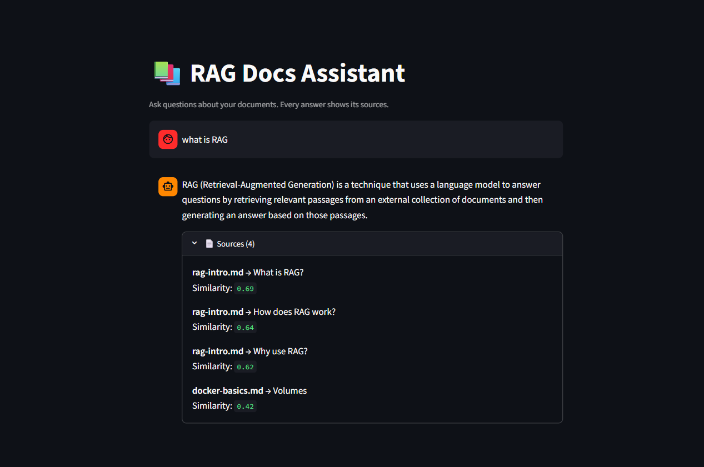
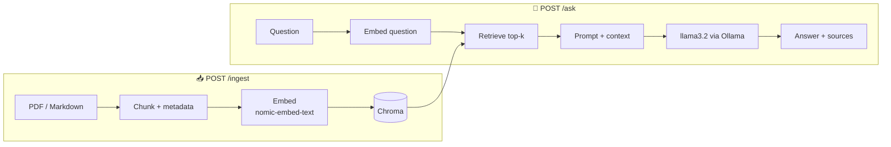
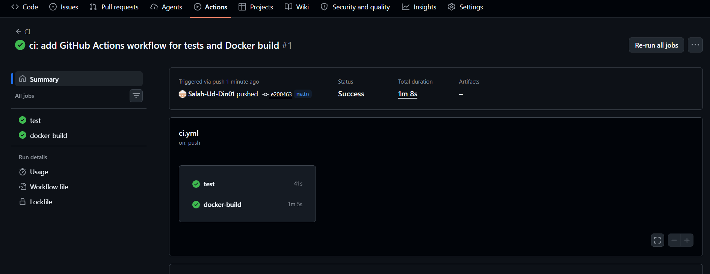

# 📚 RAG Docs Assistant

[](https://github.com/Salah-Ud-Din01/rag-docs-assistant/actions/workflows/ci.yml)


A question-answering API that answers **only from your own documents** and shows **exactly which document and section** each answer comes from. Runs 100% locally with [Ollama](https://ollama.com) — no API keys, no cloud, nothing leaves your machine.



## 💡 Why this exists

Ask a plain language model *"What is RAG?"* and, without context, it can answer confidently and wrongly:

> ❌ **Model alone:** *"RAG (Red, Amber, Green) is a traffic light system used in the UK…"*

RAG (Retrieval-Augmented Generation) fixes this by first **retrieving** relevant passages from your documents, then letting the model **generate** an answer grounded in them — with sources you can verify:

> ✅ **With RAG:** *"RAG stands for Retrieval-Augmented Generation, a technique where a language model answers questions using information retrieved from an external collection of documents."*
> 📄 Source: `rag-intro.md` → *What is RAG?*

If the answer isn't in the documents, it says **"I couldn't find this in the provided documents"** instead of guessing.

## ✨ Features

- 📥 Ingest **PDF and Markdown**, split into chunks that remember their file and section
- 🔎 **Semantic search** — finds passages by meaning, not keywords
- 🧾 **Source citations** on every answer (document + section + similarity score)
- 🚫 **Refuses to hallucinate** — answers only from the documents
- 🔒 **Fully local** via Ollama — no API keys, no data leaves the machine
- 🧪 **Tested without a model** — 17 tests run in CI using fakes, no Ollama or GPU needed
- 🐳 **One command to run everything** with Docker Compose
- 📊 **Measured quality** — an evaluation script reports retrieval and answer accuracy

## 🏗️ Architecture



The system runs as three containers: a **Streamlit** chat UI → a **FastAPI** backend → **Ollama** (models). They talk over an internal Docker network.

## 🚀 Quick start

**Requirements:** Docker Desktop.

```bash
git clone https://github.com/Salah-Ud-Din01/rag-docs-assistant.git
cd rag-docs-assistant
docker compose up --build
```

The first run downloads the Ollama models (~2.3 GB). Then open:

- **Chat UI:** http://localhost:8501 — click *Index documents*, then ask a question
- **API docs (Swagger):** http://localhost:8000/docs

Add your own `.pdf` or `.md` files to `data/docs/`, click *Index documents*, and ask away.

## 🔌 API

| Method | Endpoint | Description |
|---|---|---|
| `GET` | `/health` | Service status |
| `POST` | `/ingest` | Load, chunk and index all documents |
| `POST` | `/ask` | Ask a question → answer + sources |

## 📊 Evaluation

An evaluation set of questions with known answers measures quality:

```bash
python -m eval.run_eval
```

| Metric | Result |
|---|---|
| Retrieval hit rate | **100%** (8/8) |
| Answer accuracy | **100%** (8/8) |

*Baseline on a small, in-domain set. Next step: expand with harder, adversarial and out-of-scope questions to probe where it breaks.*

## 🧪 Tests & CI

```bash
pip install -r requirements-dev.txt
python -m pytest -v
```

All 17 tests use **fake** embeddings and a fake LLM, so they run with no model, offline and free. GitHub Actions runs them and builds the Docker image on every push.



## 🧰 Tech stack

| Area | Tools |
|---|---|
| API | FastAPI, Pydantic |
| RAG | LangChain |
| Embeddings | `nomic-embed-text` (Ollama) |
| Vector DB | Chroma (cosine) |
| LLM | `llama3.2:3b` (Ollama) |
| UI | Streamlit |
| Testing / CI | pytest, GitHub Actions |
| Delivery | Docker, docker-compose |

## 🛠️ Running locally without Docker

```bash
python -m venv .venv && source .venv/Scripts/activate   # Windows (Git Bash)
pip install -r requirements-dev.txt
ollama pull llama3.2:3b && ollama pull nomic-embed-text
uvicorn app.main:app --reload            # terminal 1 — API
streamlit run ui/streamlit_app.py        # terminal 2 — UI
```

## 👤 Author

**Salah Ud Din**